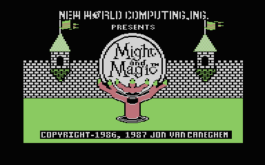
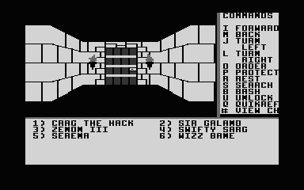
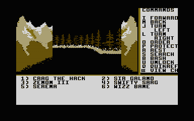
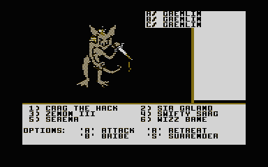

# Might and Magic: Book One for the stock Atari 65XE (64 KB)

*Might and Magic: Book One, Secret of the Inner Sanctum* (New World Computing, 1986/87), running on an **unexpanded 64 KB Atari** (65XE, 800XL, or an XL/XE emulator with 64 KB) from four disks, with the original animated title and tune, the game's menus, 3-D views, combat, shops, disk swaps and saved games.

> **This is an unofficial fan port.** It is not made, endorsed or supported by New World Computing, 3DO, Ubisoft or any other owner of the game. *Might and Magic* and everything in the original game, its code, graphics, text, music, sound and data, are the copyright and trademark of **New World Computing, Inc.** and of the present owners of those rights. See "Rights and credits" below.

This is the 64 KB sibling of the [130XE port](../github/README.md). It is not a rewrite either: the C64 game's own 6502 code runs on the Atari, unchanged apart from the few instructions that address the C64's video, sound and timer chips, and a small Atari kernel stands in for the rest of the C64. The 130XE version keeps a converted copy of the screen and its colour tables in an extra 16 KB memory bank, which a 64 KB machine does not have. This version instead **shows the game's own two C64-format bitmaps directly** and changes colour and character-set base per row with display-list interrupts. That fits, at the cost of colour (see "Differences").



| | |
| --- | --- |
|  |  |
|  |  |

*Atari800 at 64 KB. The first and second pictures are the intro (the title and one of its eight scenes); the town and combat are the default grey build; the outdoors and the encounter below it are the optional colour build.*



## What is here

Four disk images, one for each C64 disk side, as **enhanced-density** Atari disks (1,040 sectors of 128 bytes, 130 KB), which is what a stock 1050 formats.

| File | Disk | Holds |
| --- | --- | --- |
| `mm1-65xe-disk1.atr` | 1 (the C64's side A) | Boot disk: the original title program and its scenes, the game's resident code. Boots the machine. |
| `mm1-65xe-disk2.atr` | 2 (side B) | Sorpigal, the dungeon beneath it, the roster. **Saved games are written here.** |
| `mm1-65xe-disk3.atr` | 3 (side C) | The country outside the town |
| `mm1-65xe-disk4.atr` | 4 (side D) | The far country and its castles |
| `colour/mm1-65xe-colour-disk1.atr` | 1, colour variant | Boot disk with the warm four-colour palette instead of grey. Disks 2, 3 and 4 are the same for both: use the ones above. |

The game asks for each disk in its own words, `INSERT DISK B AND PRESS 'RETURN'`, as it did on the C64 (its disks are A to D, these are 1 to 4).

SHA-256:

```
636cbe07709d07e651f885244112c5fd87df95ee6fc54707be5ded70166e1459  mm1-65xe-disk1.atr
3d923d5324cd02c3ae5ab0dc67445710e70cfaadbba1d12cd11c343b030fe93f  mm1-65xe-disk2.atr
88452edd47b838736068c7b98038fd4967af5aed963091890323fe65b820d899  mm1-65xe-disk3.atr
43d0d5e48260b2427ad7e71391ddef43440717bb847caed6c65b6f2aae8af5e3  mm1-65xe-disk4.atr
374139852b32b69e22c321e267a7317d619ea4496d6706bd9675774d85c52f57  colour/mm1-65xe-colour-disk1.atr
```

Also in this folder: [`docs/`](docs/) (the notes specific to the 64 KB build) and [`src/`](src/) (the source). The 130XE disks are in [`../github/`](../github/) and are not interchangeable with these: that build needs 128 KB, and this one does not use it.

## What you need

- An **Atari 65XE or 800XL (64 KB)**, or an emulator set up as one: XL/XE, **64 KB**, BASIC off, NTSC.
- For a real machine, a drive that can read an enhanced-density (130 KB) disk, such as a stock 1050, and a way to write the images to disks (see "Real hardware").

## Running it in an emulator

Work on **copies** of the images: the game writes your characters to disk 2.

**Atari800** (Linux, macOS, Windows):

```
atari800 -xl -nobasic -ntsc -no-kbdjoy0 -no-kbdjoy1 mm1-65xe-disk1.atr
```

`-xl` is the 800XL, which has 64 KB. The two `-no-kbdjoy` options stop Atari800 from taking W, A, S, D and the numeric keypad as joystick keys, which would never reach the game. On Windows run `atari800.exe` the same way. Atari800 needs an XL OS ROM, or its built-in replacement; the checks here used the built-in one (`-xl-rev altirra`).

**Altirra** (Windows, or AltirraSDL on Linux): choose an XL/XE machine with **64 KB**, BASIC off, NTSC; boot `mm1-65xe-disk1.atr` in D1. Mount disk 2 **read/write** (not "virtual"), or the saved games are not kept.

### Playing

1. The original C64 title program runs first: the two animated title frames, its tune (the C64's three voices, translated to POKEY) and, if you press SPACE, the eight intro scenes. Press **ESC** to start. The game loads.
2. The game asks for disk B. In Atari800 press **F1**, open *Disk management*, insert `mm1-65xe-disk2.atr` in D1, close the menu, and press **RETURN**. In Altirra use the Disk menu to change D1. Press RETURN in the game.
3. The options menu offers `C` (create characters), `V` (view all characters) and `#` (go to town); the supplied six characters are at the Inn of Sorpigal. There **CTRL-A to CTRL-F** add the characters to the party.
4. Play with the keys shown on the screen: `I` forward, `M` back, `J` turn left, `L` turn right, `#` a character's sheet, and so on. The manual that came with the game applies.
5. When the party leaves Sorpigal for the outdoors the game asks for **disk C** (`INSERT DISK C AND PRESS 'RETURN'`), and later for disk **D**. Swap the disk in D1 as before and press RETURN. If you leave the wrong disk in, or none, the game simply asks again.
6. **Save** by signing in at the Inn of Sorpigal. The roster is written to disk 2, so disk 2 must be the writable image, and in the drive, when you sign in (the game asks for it if it isn't).

To start again after a restart, boot disk 1 again, then swap to disk 2 when asked: the party you saved is on disk 2.

## How it fits in 64 KB

The old extra bank held presentation support, not game logic. The 65XE build removes it by displaying the game's bitmaps in place, in ANTIC mode 4: nineteen of the 25 bitmap rows display from the memory the game drew them in, and the six rows that cross a 1 KB character-set boundary are copied into two shared 1 KB blocks. A display-list interrupt sets the character-set base for each row. The OS is switched out while playing and switched back for each disk transfer. Both of the game's bitmaps and its page flipping are kept, because before every fight the game copies its resident code into the memory under the lower bitmap and restores it afterwards; the loader, the stand-in chips and the display code together take about 2 KB of main memory. The four-disk loader has **2 free bytes** and the display code 7, so this is a tight fit, not a platform with room to add things.

The intro runs from temporary memory before the game loads, and is gone when you press ESC; the resident part of the program is identical with and without it.

The disks use the same format as the 130XE ones: every file and picture is compressed on its own (ZX02), padded to whole sectors, with an index at the end of each disk. Disk 1 uses 468 of its 1,029 data sectors, disk 2 795, disk 3 749 and disk 4 743.

The full description, with the memory allocation, the rules the patches obey and the measurements, is in [`docs/65XE.md`](docs/65XE.md); the study that came before it is [`docs/64K-FEASIBILITY.md`](docs/64K-FEASIBILITY.md).

## Differences from the C64 and from the 130XE version

- **Colour.** The C64 chooses colours for every 8×8 cell, and the 130XE version approximates that row by row. Here the whole screen uses one fixed palette of four tones for the graphics: shades of grey by default, or black / dark brown / gold / white on the `colour/` boot disk. Menus and text are white on black. Monsters, walls and pictures are recognisable, but their original hues are lost, and the blue encounter panel is not blue. The intro's scenes are in colour.
- **Sound.** The title tune is the original, translated to POKEY. **The game's sound effects are not translated in this build** (the 130XE version translates them); the game's own sound code still runs.
- **Speed.** Walking forward takes about 12 frames (a fifth of a second) from key to next key wait in an NTSC emulator, against about 29 for the 130XE version, because the screen is no longer converted. Redraws can show brief horizontal tearing on the shared rows while they are copied; the old view is not erased before the new one is published.
- **Keyboard.** The Atari keyboard stands in for the C64's. The ESC key is the C64's left-arrow ("Escape").

## Status

**Tested:** a recorded set of 21 play sessions at exactly 64 KB, covering the menu, making and saving characters, all five town services, fights (won and lost, and retreat, bribe and surrender attempts), spells, shooting, chests and their traps, death and the temple, the outdoors, and the swaps to disks B, C and D: 257 checkpoints on four disks in Atari800. On every one the game's memory equals the memory of a reference model of the C64 game at every checkpoint (apart from the display and input-timing differences listed in `docs/65XE.md`), the picture equals a model of the original bitmap pixel for pixel, and so does what the game writes to the disk. Saving, a cold restart and reloading were checked in both Atari800 and AltirraSDL with the Atari OS doing the serial transfers, and the colour disk in both as well. The title, its eight scenes, ESC and the hand-over to the game were checked pixel for pixel in both. Ordinary keyboard play (not scripted) boots, makes a party, enters the town and walks.

**Not tested:** a real Atari and a real drive; playing the whole game through; PAL machines (the picture timing is NTSC); areas, spells and rare situations outside the 21 sessions; DOS-booted variants. Real-machine load times and keyboard feel are not measured.

## Real hardware

**Not tried yet.** Everything above was checked in the Atari800 and AltirraSDL emulators. What a real 65XE and 1050 will do is not known. The images are ordinary ATR files of 1,040 sectors of 128 bytes (133,120 bytes plus the 16-byte header). Write them to real disks with a tool that can write enhanced-density ATRs (SIO2PC and its relatives, an Atari-to-PC link, or a modern floppy emulator). Disk 2 must not be write-protected: that is where the game saves. The first read after a disk change may fail on a real drive; if the prompt comes back, press RETURN again. [`src/REALHARDWARE.md`](src/REALHARDWARE.md) has the study of the drive side and the open questions.

If you try it, please tell me what happened.

## Source

The port's source is in [`src/`](src/): the Atari kernel, boot code, the 64 KB display and the title stage (6502 assembly), the build and disk-layout tools, the host-side model of the C64 game used to check it, the recorded key sessions, the tests, and the design notes and the full porting log. [`src/README.md`](src/README.md) says what is where and how to build. The tree also builds the 130XE version; `--65xe` selects this one.

The original game is **not** included in the source: the disk images, manuals and anything generated from the game are left out, so to rebuild the disks you need your own copy of the original. The build is not a one-command affair: it also needs cc65, VICE (to capture the C64 state the checks start from) and the Atari800 library, found through an environment variable. Built that way, the source produces exactly the disk images in this folder (checked by rebuilding them and comparing hashes).

## Rights and credits

- ***Might and Magic: Book One, Secret of the Inner Sanctum*** was created by **Jon Van Caneghem** and published by **New World Computing, Inc.** (1986; the title screen reads "Copyright 1986, 1987 Jon Van Caneghem"). All rights in the game, including its program code, artwork, text, music and sound effects, its name and its trademarks, belong to New World Computing and to whoever now holds those rights. "Might and Magic" is a trademark of its owners.
- **This is a fan project.** It is not affiliated with or approved by the rights holders. It was made out of admiration for the game and to learn how its 6502 code could run on another machine, the stock 64 KB Atari. It is non-commercial, there is no charge for it, and no one may sell it.
- **The disk images contain the original game**, converted to run on the Atari: its code and data are New World Computing's, not the author's. They are shared for preservation and interest only, with no claim of ownership over any part of the game. If you do not own the original game you should not rely on these, and you should use them only where the law allows.
- **Atari**, **65XE**, **800XL**, **130XE**, **1050** and related names are trademarks of their owners. The port does not use any Atari ROM or software: the Atari's own operating system in your machine or emulator does the disk transfers, and the text font is read from it at run time.
- The ZX02 compressor and decoder used to fit the game on the disks are by Daniel Serpell and Einar Saukas (MIT and BSD-style licences); see [`src/tools/zx02/`](src/tools/zx02/).
- If you are a rights holder and would like this changed or removed, please say so and it will be.
