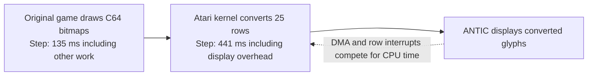

# Graphics performance deep dive — 2026-10-11

**Checked:** Atari screen conversion is the main movement bottleneck. The
unchanged game's own work takes about 125–135 ms per measured move/turn;
converting its C64 screen for ANTIC adds about 440 ms. Optimize the Atari
conversion layer first. The initial investigation applied no production
optimization; the three paths are now implemented (follow-up below).

The owner also confirms the freshly copied ATR no longer shows the `2`s and
attributes the earlier report to copying the wrong image. No additional
reverse-transition kernel fix was necessary; log entry 24's open report is
superseded by this confirmation.

## Measured latency

Atari800/libatari800, 130XE, NTSC, Altirra OS, patched SIO, first-poll scripted
inputs. Emulated time, not host Python execution time. Timer is the native
monotonic scanline clock, at 1,789,790 cycles/second, with 114-cycle resolution.
Intervals start when the scripted key is consumed and end at the next held
key wait. Frame counts include frame rounding; two final publication frames
are excluded. Consequently the precise intervals differ slightly from
`frames * 1000 / 59.923` in the older speed report.

| Action | Frames | Game / other kernel work, ms | Screen conversion including DMA / interrupts, ms | Total measured interval, ms |
| --- | ---: | ---: | ---: | ---: |
| Enter town | 86 | 1,135.99 | 288.66 | 1,424.66 |
| Step | 35 | 135.16 | 440.58 | 575.74 |
| Turn left | 34 | 125.16 | 440.32 | 565.48 |
| Turn right | 35 | 134.78 | 440.19 | 574.97 |
| Scripted `#` character prompt | 26 | 0.45 | 421.40 | 421.85 |
| Character sheet | 6 | 80.13 | 6.69 | 86.82 |
| Return from sheet to town | 26 | 132.93 | 288.73 | 421.66 |

Conversion is **76.5% of the walking step**. Original VICE PAL movement,
independently measured earlier, is 143.4 ms forward / 129.7 ms left / 142.5 ms
right. Atari's work outside conversion is already close to those whole-action
C64 times. Enter-town's other work includes loads and should not be described
as geometry alone. The return-to-town conversion is faster because DMA is
already blanked for the text-to-bitmap transition.

The `#` case is striking: a 0.45 ms handler causes 421 ms of redundant
conversion, with **no output pixel or palette changes**. GETIN's `key_given`
flag forces a refresh even for a fast action that does not draw. Do not simply
remove that flag: other fast actions draw within two frames, and continuous
idle polling updates the timestamp, which could then leave their new picture
unpublished indefinitely. Also, this is the script hook's `$23`; the current
normal keyboard strips SHIFT and does not produce the same `#` binding.



## Conversion CPU work

**Checked:** the actual before-refresh RAM snapshot is executed on the host
6502 core, with an instruction trace and indexed/branch page-crossing
penalties added to the core's base cycle counts. No display DMA or interrupts
are included in this instruction sum. All seven completed converted buffers
(including cache padding) and all row palettes equal the native emulator's
results, not just a mathematical pixel approximation.

The walking refresh needs **414,862 CPU instruction cycles**:

| Part | CPU cycles | Share |
| --- | ---: | ---: |
| Palette calculation / cache handling | 132,826 | 32.0% |
| Eight-byte pixel translation / stores | 152,000 | 36.6% |
| Cell setup, mapping selection, eight operand patches | 82,600 | 19.9% |
| Pointer advances, cell/row loops, completion | 45,634 | 11.0% |
| Row setup and entry | 1,802 | 0.4% |

The eight pixel instructions cost 19 cycles per byte, without read page
crossings: indirect source load 5, TAX 2, aligned lookup 4, indirect store 6,
DEY 2. But those 152,000 cycles are only 37% of the kernel's CPU work. Improving
just the byte lookup misses the considerable palette and cell overhead.

Warm movements calculate histograms/mappings for 16 rows and restore cached
mappings for nine. The upper rows have colour RAM 1 in the first 30 columns
and 3 in the panel's ten columns, so the existing all-40-cells-uniform shortcut
cannot apply. Their matrices also differ across the measured page-flipped
views. A two-region uniform palette cache would help the unchanged `#` view,
but the matrix changes prevent assuming it would hit on ordinary movement.
Rows 0–5 have no palette record; extending the existing record format to all
six would require 360 bytes, beyond the 76 unused display-padding bytes.

## Display overhead is substantial

**Checked:** the same walking conversion spans **788,538 elapsed machine
cycles**, while its instructions consume 414,862. The remaining 373,676 are
DMA, interrupt work and waits, subject to scanline measurement resolution.
There are 637 row DLIs during that interval. Do not label the whole difference
as DMA; it includes the kernel/game interrupts and WSYNC waits.

Diagnostic temporary-RAM experiments separate this cost:

| Action | Normal | DMA blanked during conversion | Conversion bypassed |
| --- | ---: | ---: | ---: |
| Step | 35 frames | 24 | 8 |
| Turn left | 34 | 23 | 7 |
| Turn right | 35 | 24 | 7 |
| Scripted character prompt | 26 | 15 | 1 |
| Character sheet | 6 | 6 | 5 |
| Return to town | 26 | 26 | 8 |

Blanking reduces the walking conversion interval to 456,000 cycles, about
255 ms, but produces a visible black flash. The bypass leaves the inn screen
stale throughout play. These are diagnostic bounds, **not usable fixes or
claimed implementation gains**. The text-to-graphics path already blanks,
so blanking again does not improve it.

## How much is actually dirty?

**Checked:** every refresh still converts 1,000 cells / 8,000 pixel bytes.
Against the prior displayed buffer:

| Action | Changed converted cells | Changed converted bytes | Rows with changed palettes |
| --- | ---: | ---: | ---: |
| Step | 336 / 1,000 | 2,332 / 8,000 | 16 / 25 |
| Turn left | 324 / 1,000 | 1,922 / 8,000 | 16 / 25 |
| Turn right | 324 / 1,000 | 1,922 / 8,000 | 16 / 25 |
| Scripted character prompt | 0 | 0 | 0 |

All bottom nine rows, including party names and blank lines, remain unchanged
for these four actions. They consume **118,570 CPU cycles**, 28.6% of a warm
walking conversion. The panel is also stable in appearance, but shares rows
and palette selection with the changing 3D view, so skipping it requires
more care than a whole unchanged lower row.

The saved snapshots compare logical visible source rows across C64 bitmap
page flips, not simply identical physical addresses. Raw cell changes and
converted changes differ because the mapping is lossy; changing a row palette
can also require new encoding even for an unchanged source cell.

## Original 3D drawing

**Read / host-profiled:** the existing oracle was traced at every instruction
for the same non-loading actions. Page penalties were added to the reported
instruction sums, without changing its IRQ clock. This is an attribution
model, not a real DMA-inclusive C64 measurement:

| Original routine / region | Step CPU cycles | Left-turn CPU cycles |
| --- | ---: | ---: |
| Wall-piece copying / compositing, `$1111–$1257` | 68,643 | 59,613 |
| Hidden-view clear, `$1F36–$1F64` | 42,713 | 42,727 |
| Play-screen colour fill, `$C276–$C2AF` | 10,179 | 10,172 |
| View control, `$0F1D–$1110` | 438 | 386 |

One clear writes 3,840 view bytes. The step invokes three wall pieces; the
left turn invokes two. Thus there is meaningful original drawing work, but
the Atari converter alone uses roughly three times the original game's
instruction cycles, then incurs display contention. Rewriting the original
clear/compositors is a lower priority and conflicts with the standing rule
against changing game binaries beyond hardware operand redirection.

## Recommended prototypes, in order

### 1. Avoid patching an unchanged lookup page

**Measured inputs / estimated gain:** 830 of 1,000 successive cell mapping
pages repeat on a walking step; 848 repeat on a left turn. The current loop
still performs eight absolute STA instructions (32 cycles) for every cell.
Compare the newly calculated page with `table0+1`, the current high operand
byte, and branch around those eight writes when equal:

```asm
        adc #>MAPS
        cmp table0+1
        beq @table_ready
        ; existing eight STA tableN+1 instructions
@table_ready:
        ldy #7                  ; must run even when the patch is skipped
        ; existing eight-byte conversion
```

All eight operand bytes must remain synchronized; compare/update the whole
set's page, not one instruction alone. This adds five code bytes and no cache
RAM. With an absolute CMP and same-page BEQ, the measured walking pattern
suggests `830*25 - 170*6 = 19,730` CPU cycles saved, about 4.8% of conversion
CPU work, roughly one to two frames. This is **estimated**, not benchmarked.
Check branch page placement and actual frames after assembling. This is the
smallest, clearest first experiment under the current code/memory budget.

### 2. Copy directly for the identity mapping

**Measured inputs / estimated gain:** table index 9 maps every byte to itself.
It occurs in 374 cells on the step/right turn, but only 140 on the left turn.
An unrolled source-to-destination copy can omit TAX and the lookup, saving six
cycles per pixel byte, and can omit the eight operand patches too. Account
for the dispatch/jump overhead and lower-hit screens; savings are content
sensitive. It needs another roughly 40-byte pixel loop plus branching, whose
final segment fit must be assembled. Do not add its estimated savings to
prototype 1 without accounting for their overlap.

A branch around lookups for zero bytes is a poor general choice here: only
1,362 / 8,000 walking source bytes are zero (17%). A BEQ saves about three
cycles on zero bytes but adds two on nonzero bytes, needing about 40% zeros
to break even. The observed screen predicts about 9,190 cycles **lost**.

### 3. Reuse exact unchanged rows without a raw bitmap cache

**Predicate checked; runtime implementation not done.** A general exact raw
cache would need approximately 10 KB and does not fit. However, the existing
converted display can serve as a comparison source for a narrower case.

Let a cell's lookup be `f`. Some lookups are **idempotent**, meaning
`f(f(x)) = f(x)` for every byte. Then the previous output `d=f(old_raw)` is a
fixed point. If the new raw bitmap byte equals `d`, applying the same lookup
cannot change the output. The valid table indices are
`0,1,3,5,8,9,10,11,12,13,15`. Table 6 swaps pairs and is a known negative:
`$55 → $AA → $55`; equality with the old converted bytes alone is unsafe.

A safe row shortcut needs **all** of these conditions:

1. A completed previous bitmap exists (`shown_mode != 0`); no text reuse or
   cold/incomplete cache is being treated as previous graphics.
2. The old and current palette **inputs** match exactly: all 40 matrix bytes
   and the effective colour-RAM pattern. The current uniform cache hit can
   prove this for the lower rows. A mapping-only `cc_restore` reached after
   recalculating a varied row is not that proof.
3. Every lookup used by cells in the row is idempotent under those unchanged
   mappings, including the unchanged panel/register interpretation.
4. All 320 current raw row bytes equal the prior 320 converted display bytes.

Then retain the row's pixels and palettes. Otherwise use the existing full
conversion. A newly written cache record on a miss is not proof of matching
old inputs; track whether the exact fast hit occurred before changing the
record. A compare that advances source/destination pointers must restore
their original row starts before falling back to the cell loop. `row_skip_candidates()` verifies this predicate against full
native conversion; it finds **all nine bottom rows** on each measured move,
turn and unchanged character prompt. It rejects the text-to-graphics cases.
All 16 tables × 256 bytes are checked for idempotence, with the pair-swapping
negative control. This is not proof of an assembly implementation or broad
game coverage; it is a concrete safe condition for a prototype.

A tight 320-byte indirect compare is roughly 5.5–6.5k CPU cycles per full row,
including loop/page overhead, versus roughly 11.3k for that row's pixel/setup/
advance work. Retain palette validation; do not claim all 118,570 bottom-row
cycles can disappear. This suggests roughly 40–50k CPU cycles saved on the
measured walk (10–12% of conversion), before additional qualification costs.
Actual timings remain to be measured.

An optional per-row qualification byte plus one per-call exact-cache-hit
flag needs about 26 bytes, rather than 10 KB. **Read from the current layout:**
`$63D4–$63FF` has 44 contiguous spare display bytes after the last 60-byte
palette record and before FONT `$6400`; another 32 unused bytes are scattered
among the first eight records. Code space remains tight: EXT 50 and EXT2 173
spare bytes. Preserve cache invalidation on text reuse and row input changes,
and validate each fast-hit row against forced full conversion.

## Validation and limits

- The uninstrumented control and probed normal run have identical frame
  counts, all seven settled RGB images, and all seven game-byte hashes under
  the existing lockstep comparison rules. No new exclusions were added.
- The blanking and bypass diagnostics also preserve those compared game
  bytes. Blanking retains all final images; bypass deliberately does not.
  The black conversion interval and stale inn were visually inspected.
- Host refresh output equals native output for all seven snapshots, including
  row palettes and cache padding. The host model omits DMA/interrupts; the
  native timer includes them and has scanline resolution. Temporary escape
  callbacks emulate displaced instructions/cycles; the matched control
  bounds perturbation but is not a hardware timing guarantee.
- The two existing speed/cache tests pass (2.399 seconds), including fifty
  cached/full palette cases. No production shader, build or game-file change
  was made, so the full 81-test runtime suite was not rerun for this analysis.
- This deep profile is one NTSC town route in Atari800. Altirra previously
  agreed on action frame counts; these per-stage probes were not run there.
  PAL, Atari ROM and physical hardware remain outside this measurement.
- The stock 130XE cannot put CPU and ANTIC on different extended banks at
  once. A second-bank cache read while ANTIC remains on bank 0 is invalid.
  Keeping exact direct comparisons avoids hash collisions. Blanking every
  walking step or rewriting original bitmap address arithmetic is not the
  recommended first implementation.

Reproduce with `port/atari/graphics_profile.py`, using `--experiment control`,
`skip`, or `blank` for the diagnostic variants. It builds the test kernel,
patches **only emulator RAM**, restores those bytes afterwards, and always
rebuilds the normal playable ATR even if capture/setup/analysis fails.
[Raw reports, snapshots, pictures and checks](../test-artifacts/graphics-profile/README.md).
The analysis-only ATR was the existing playable source at `9d64689`, SHA-256
`0039e59910fc729cecb11f7a12cd20ff76801acc353f4f0c8fc7f1f59e5ba17a`.

## Implementation follow-up — 2026-10-11

**Checked:** all three optimizations now run in `kernel.s`. The original game
files, hardware redirections, comparison rules and display interrupts are
unchanged. Native Atari800 NTSC measurements on the same first-poll route:

| Action | Before frames | After frames | Before conversion, ms | After conversion, ms |
| --- | ---: | ---: | ---: | ---: |
| Enter town | 86 | 86 | 288.66 | 287.77 |
| Step | 35 | 30 | 440.58 | 364.08 |
| Turn left | 34 | 30 | 440.32 | 375.23 |
| Turn right | 35 | 30 | 440.19 | 364.14 |
| Scripted character prompt | 26 | 21 | 421.40 | 345.80 |
| Character sheet | 6 | 6 | 6.69 | 6.69 |
| Return to town | 26 | 25 | 288.73 | 280.83 |

**Checked in AltirraSDL:** the same route takes 86 / 30 / 31 / 30 / 21 /
6 / 25 frames in table order. Left differs by one frame from Atari800;
the previous Altirra baseline was 34 frames. All seven final Altirra RGB
pictures remain identical to its own baseline. Both emulators' ordinary
idle sample finds zero conversions, with a working forced-refresh control.

Walking conversion uses 342,179 CPU cycles instead of 414,862: **17.5% less
CPU work**, and **17.4% less elapsed conversion time** including display
contention. Input-to-wait frames fall by 14.3% for the forward/right actions
and 11.8% for left. These are combined measured gains, not the sum of the
earlier individual estimates. The left turn has fewer identity cells.

The implementation:

- Compares the selected lookup page with the current operand page before
  updating all eight operands. Identity copies leave those eight operands
  coherent for the next translated cell.
- Dispatches table 9 to an eight-byte unrolled direct copy, then rejoins the
  shared pointer advancement. All 256 byte values and mixed identity/swapping
  transitions are tested independently against generated lookup tables.
- Stores 25 row qualification bytes and one exact-hit byte at `$63D4–$63ED`.
  Qualification is calculated only when saving a uniform cache record, and
  all 40 matrix-selected mappings must be idempotent. A miss cannot reuse
  its newly qualified record: only a later exact uniform input hit sets
  `cache_hit`. Varied rows, uncached rows 0–5, text/cold starts and unsafe
  mappings fall back to full conversion. The 320-byte equality check restores
  both pointers on every exit. All nine bottom rows skip conversion during
  the measured steps, turns and unchanged scripted prompt: **640 cells are
  converted instead of 1,000**. Upper-row palettes still need calculation.

**Checked memory layout:** the fast copy and row routines occupy EXT2.
Moving 32 bytes of palette scratch to UNDER leaves room without another
bank. UNDER explicitly reserves the existing 25-byte native test trampoline;
the sound and Altirra helpers use its label. Spare bytes are LOADER 8, UNDER
4, EXT 30 and EXT2 26. Display padding retains 50 spare bytes, of which 18
are contiguous after the qualification flags. No extra boot sectors or game
RAM allocation. The idle sampler now uses code labels rather than the moved
scratch address as its range boundary.

**Checked correctness:** all seven optimized native benchmark endpoints
match the baseline's game-byte hashes and RGB pixels under the existing
comparison rules. Host profiling reproduces the optimized native buffers
and palettes. `graphics_check.py` runs 24 differential refresh cases against
the captured original kernel, including misses at six byte boundaries,
matrix/colour-RAM changes, high-bit-only colour-RAM writes, mode switches,
text reuse and stale positive qualification flags. It checks all 16 mapping
qualifications, every source byte under all 16 lookups, a mixed-page/identity
sequence and the known pair-swapping negative. See
[implementation evidence](../test-artifacts/graphics-optimized/README.md).

All 82 unique regression tests pass: 80 inside the sandbox and the two
Altirra play checks after rerunning their module with approved local-socket
access (all three module tests pass). Eight lockstep sessions / 106
checkpoints, three exact saves, ordinary keyboard play, nine sounds and both
Altirra disk modes are retained. The final three speed tests also pass with
the stricter 30-frame Atari800 movement / 25-frame return limits. The new
uninstrumented control matches all seven probed action frame counts,
game-byte hashes and final pixels.

The capture route and host checks are not whole-game visual coverage.
PAL, physical hardware and Atari's own ROM remain untested. Sound pacing is
unchanged. Reproduce sequentially because all tools share build output:

```bash
python3 port/atari/graphics_check.py
python3 port/atari/graphics_profile.py --out build/atari/graphics-optimized
python3 port/atari/speed_check.py --emulator altirra --out build/atari/speed-altirra
python3 -m unittest discover -s tests
python3 port/atari/build.py
```

## Subsequent palette optimization

**Checked 2026-10-11:** live mapping reuse now removes thirteen of sixteen
walking nearest-colour rebuilds. Palette CPU work 133,362 → 107,041, whole
conversion 342,179 → 315,858; elapsed conversion 364 → 335 ms and Atari800
movement 30 → 29 frames. It uses an exact ordered selected-colour key and
invalidates it on cached restores. Remaining spare bytes are now LOADER 8,
UNDER 1, EXT 14, EXT2 10; earlier layout numbers describe the three-path
implementation before this follow-up. [Complete methods, broader workloads
and validation](PALETTE-PERFORMANCE.md).

**Later colour correction, checked 2026-10-11:** converter lookups now process
two bytes per iteration and identity copying uses a loop to make room for
actual pixel-pair selection in wide encounter rows. Table-page guards and
qualified row reuse remain; that layout bypasses the old matrix-only cache.
The exact nearest-colour metric is stored symmetrically. Walking pixels
remain unchanged; improved encounter output uses an independent full-policy
reference. The profiler accepts two/eight operand aliases and its seven
native outputs replay exactly. Both emulators walk in 30 frames; all 87
tests and prior speed bounds pass. [Tradeoff](COLOUR-SELECTION.md).

**2026-10-12 follow-up:** four-byte lookup loops, two-byte identity loops, stack-free cell/histogram decoding and a derived high-byte table reduce walking 30 → 29 frames, with identical benchmark pictures and game hashes. [New baseline, measurements and verification](WALKING-PERFORMANCE.md).
