# Screenshots: Atari beside C64

Made by `python3 port/atari/screenshots.py`. Each pair is the same instant of the same scripted
session: on the left the Atari 130XE build in Atari800, on the right the C64 as the host oracle
draws it, which equals VICE's screenshot. The two machines' memory is equal at each of these
points (`port/atari/lockstep.py`); what differs is how the Atari shows it.

The Atari has three colours per row of text cells, where the C64 has three per cell, and the
kernel picks each row's three from what is on it. See "Colours" in [ATARI-DESIGN.md](ATARI-DESIGN.md).

Encounter colours were corrected on 2026-10-11: unused matrix colours no longer outvote
green artwork, and the full eighteen-column name panel keeps its blue background.
[Cause, validation and timing tradeoff](COLOUR-SELECTION.md).

The title and its eight scenes have a page of their own, made by
`port/atari/title_check.py --gallery`: [TITLE.md](TITLE.md), "The pictures".

| Screen | Atari 130XE | C64 |
| --- | --- | --- |
| Options menu `boot-to-menu`, mark `menu` | 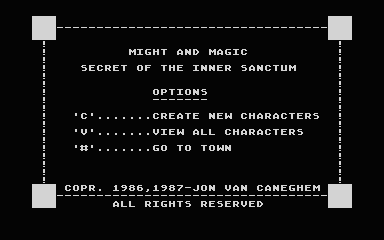 | 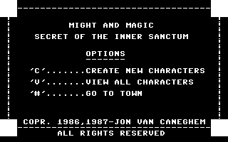 |
| Creating a character: the rolled statistics `boot-to-new-character`, mark `rolled` | 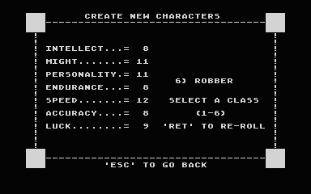 | 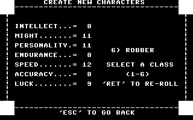 |
| Creating a character: class, race, alignment and sex chosen `boot-to-new-character`, mark `class` | 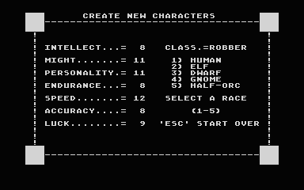 | 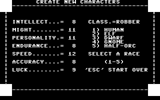 |
| The inn of Sorpigal: the roster `boot-to-town-services`, mark `inn` | 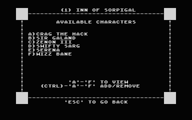 | 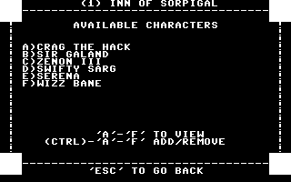 |
| Sorpigal, outside the inn `boot-to-town-services`, mark `town` | 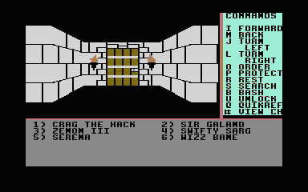 | 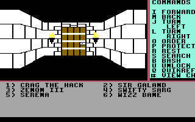 |
| At the blacksmith's door `boot-to-town-services`, mark `blacksmith-door` | 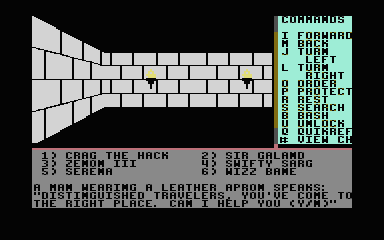 | 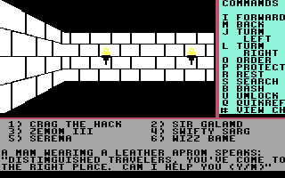 |
| The blacksmith `boot-to-town-services`, mark `blacksmith` | 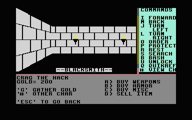 | 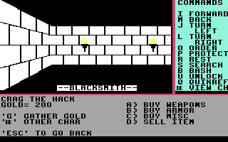 |
| The temple `boot-to-town-services`, mark `temple` | 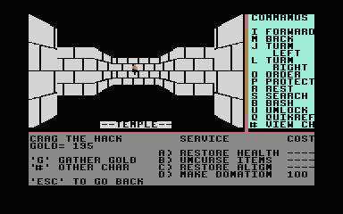 | 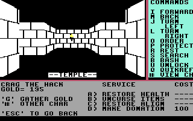 |
| The training hall `boot-to-town-services`, mark `training` | 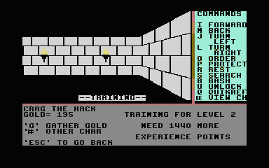 | 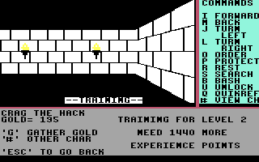 |
| The tavern `boot-to-town-services`, mark `tavern` | 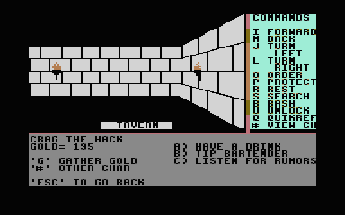 | 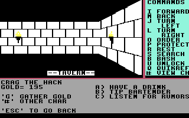 |
| A character sheet `boot-to-town-services`, mark `character` | 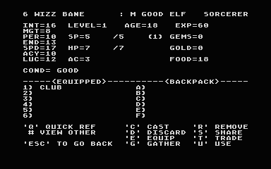 | 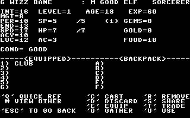 |
| The Location spell `boot-to-town-services`, mark `location` | 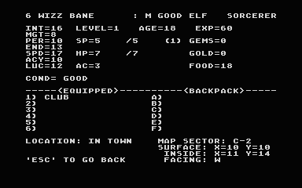 | 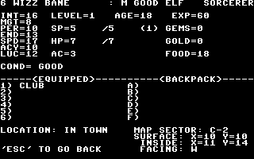 |
| The dungeon under Sorpigal, unlit `boot-to-fight-and-save`, mark `dungeon` | 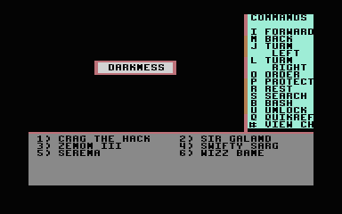 | 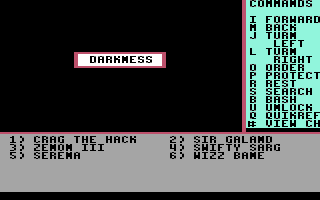 |
| The arena `boot-to-fight-and-save`, mark `arena` | 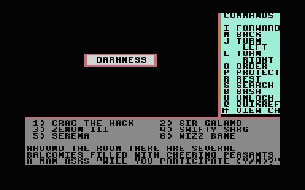 |  |
| Combat `boot-to-fight-and-save`, mark `fight` | 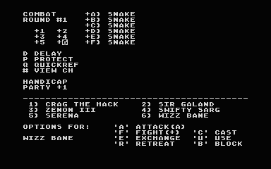 | 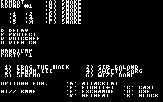 |
| After the fight `boot-to-fight-and-save`, mark `won` | 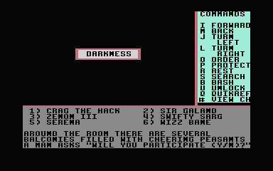 | 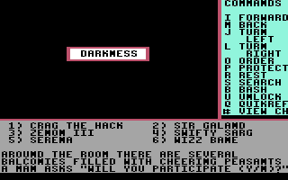 |
| Outside Sorpigal `boot-to-outdoors`, mark `outdoors` | 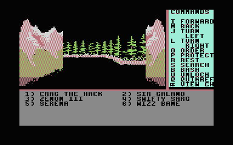 | 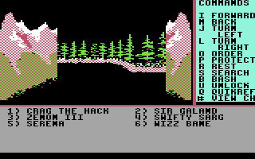 |
| One sector south `boot-to-side-d`, mark `sector-ej` | 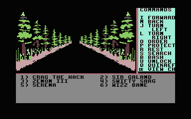 | 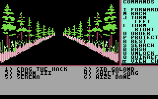 |
| An encounter in the forest `boot-to-side-d`, mark `portal` | 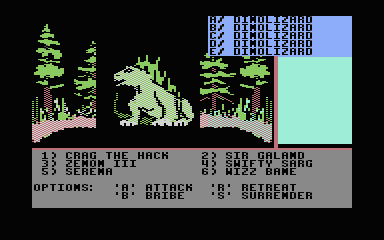 |  |
| The same encounter, still: the session never gets past it, so it never reaches the portal or disk D (corrected 2026-10-13) `boot-to-side-d`, mark `side-d` |  | 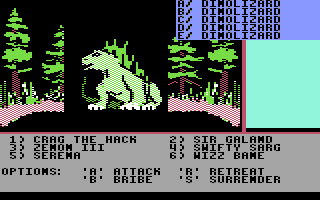 |
| A wandering group: attack, retreat, bribe or surrender `boot-to-treasure-and-reload`, mark `encounter` | 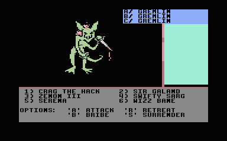 | 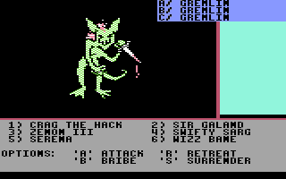 |
| Treasure found after the fight `boot-to-treasure-and-reload`, mark `chest` | 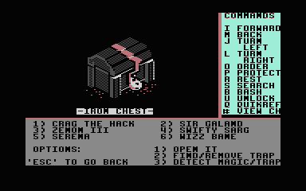 | 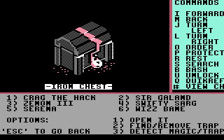 |
| After switching off and on: the saved character, halberd and all `boot-to-treasure-and-reload`, mark `sheet-2` | 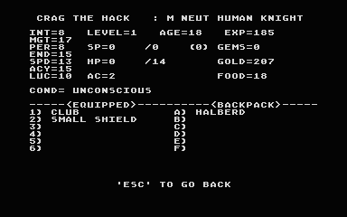 | 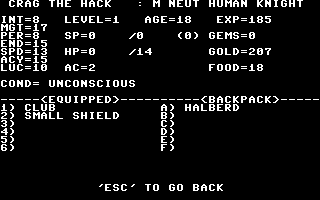 |
| The snakes' lair under Sorpigal `boot-to-death`, mark `lair` | 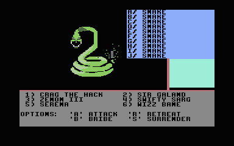 | 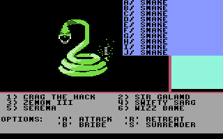 |
| The party wiped out `boot-to-death`, mark `dead` | 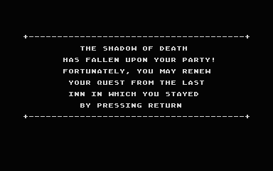 | 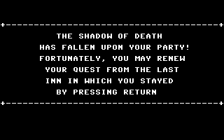 |

More gameplay pictures and VICE references are retained with the [expanded coverage evidence](../test-artifacts/gameplay/README.md). The direct-key, combat, trap, death/raising and wilderness cases use the original key-wait counters for settled C64 pictures.
