# Title: the C64's intro on the Atari

2026-10-12. The C64 title program is **read** from its listing and **traced** on the host oracle and in VICE; the Atari side is **checked** on Atari800 and AltirraSDL. Implementation: `port/atari/src/title.s`, with its tables and the disk built by `port/atari/build.py`. How it was arrived at is entry 36 of [PORTING-LOG.md](PORTING-LOG.md).

```bash
python3 port/atari/build.py                     # the disk people play: starts with the title
python3 port/atari/build.py --no-title          # starts at the game's first prompt, as the checks of the game do
python3 port/atari/title_check.py [--gallery]   # frames, tune, scenes, Escape, then a short game; about 6 seconds
python3 port/atari/title_check.py --altirra [--sio]
python3 port/atari/lockstep.py tools/traces/boot-to-menu.txt --title    # the game after the title equals the oracle
python3 -m unittest tests.test_title
python3 tools/c64_trace.py tools/traces/title-scenes.txt                # the C64 reference, in VICE; oracle.py --compare checks it
```

**In one paragraph.** The disk now starts as the C64's does: two title frames that take turns, a three-voice tune, `SPACE` for eight scenes, `ESC` to start the game. It is the C64's own title program, run unchanged apart from 25 operands that name C64 chips. Both title frames come out with every pixel in the right colour. The game that follows is the same game: all nine lockstep scripts pass with the title in front (116 marks). The kernel did not grow by a byte.

## What the C64 title program does

Side A block 0, `$0F80` bytes at `$4000`, entered at its first byte by the second boot file. *Read* from `build/source/game/title.s`; every statement below was then *traced* on the oracle unless marked. The oracle's run of the title and all its scenes equals a VICE recording in all 20 disk reads and all 11 pictures (`tools/traces/title-scenes.txt`, [recording](../test-artifacts/c64/trace-title-scenes), [ORACLE.md](ORACLE.md)); the tune's writes are the oracle's alone.

| Address | Does |
| --- | --- |
| `$4000` | Loads three of the game's tables (`$C9E8`, `$C92C`, `$8C00`), which it does not use itself. Clears zero page from `$02`, sets a dozen of the game's variables, clears the bitmap at `$E000` |
| `$40B5` | The loop: display on, two pictures loaded and unpacked, tune started, then wait for a key |
| `$4197`, `$41AB` | The wait: look for a key, count 255 × 256 times, show the other frame, again. Keys are looked for **between two frames only** |
| `$4364` | Shows a picture: copies it from its buffer to the screen in twelve steps from the edges inwards, one row at the top and bottom and two columns at each side per step, with its colours |
| `$493A`, `$4904` | Unpacks a picture: 40 columns of 25 cells of 8 bytes; `$7B`, count, value is a run. The same packing as the game's pictures |
| `$4112` | The scenes: for each of eight, set colours, load and unpack, show, wait about two seconds (`$4168`, six counting loops) |
| `$4B73`–`$4C8C` | The tune: set-up and the interrupt handler that plays it |
| `$4105` | Escape: silence, loads the game's first files (`$0B00`, `$A000`, the stub at `$2000`) and jumps to `$2000` |

**Screen.** Multicolour bitmap at `$E000`, colour matrix at `$CC00`, colour RAM at `$D800`: exactly the game's "lower" screen. Pictures are unpacked into buffers at `$2000` and `$6000` and their colours prepared at `$0400` (matrix) and `$1000` (colour RAM); showing a picture copies all three to the screen.

**Ten pictures**, all on side A:

| Picture | Block | Packed bytes | Colours |
| --- | --- | --- | --- |
| 0: "Book 1, Secret of the Inner Sanctum", `'ESC' TO START GAME 'SPACE' FOR SCENES` | `$070` | `$145E` | Every cell `$25` and white: red, green, white on black |
| 1: "New World Computing, Inc. presents Might and Magic", copyright | `$088` | `$0F4A` | The same |
| 2, 4, 6, 8: four screens of the game (town, cavern, mountains, treasure) | `$09B`, `$0BD`, `$1C4`, `$1B1` | `$0AF2`–`$1052` | A colour matrix of 1 KB loaded from blocks `$0A8`, `$1A5`, `$1AC`, `$122`; colour RAM white, cyan in the command panel's columns, grey below, as in play |
| 3, 5, 7, 9: two creatures in a frame, four lines of text | `$0B2`, `$0D3`, `$1D7`, `$12C` | `$098E`–`$0FFA` | `$25` for the frame; the left picture's cells `$EA`, `$C2`, `$3A`, `$E4`, the right one's `$52`, `$57`, `$58`, `$E2`; text cells `$BB`; all white in colour RAM |

**Time.** One change of frame takes 658,000 cycles on the oracle, 0.67 seconds: about half copying and half counting. A scene takes 2.8 million cycles besides its disk reads.

**The tune.** `$4B73` copies 25 bytes from `$4CFA` to the sound chip (pulse widths, envelopes, volume 15), keeps a waveform per voice (pulse, pulse, sawtooth) and points three voices at `$4D16`, `$4E2F` and `$4EC4`. `$4BC7` puts the handler `$4BE0` on `$0314` and keeps the old address to jump to afterwards. So it is played from the KERNAL's 60 Hz timer interrupt. Every tick each voice counts down; at zero it takes four bytes: frequency low, frequency high, length in ticks, gate. A zero low byte ends the voice and starts all three again. Voice 1 has 70 notes, voice 2 has 37, voice 3 has 19; a round is 850 ticks, 14.2 seconds. *Checked:* this decoding predicts all 859 writes the oracle's title program makes to the sound chip in 1,900 ticks (`title_check.py`).

**The notes are in tune on an NTSC C64**, not a PAL one: `$1C31` is 439.94 Hz with the NTSC clock and 423.8 Hz with the PAL one. The game's nine effects were converted with the PAL clock ([SOUND.md](SOUND.md)); for a tune the NTSC value is the right one.

**Two things it does that nothing shows** (*traced*):

- When it moves a picture's colours it also writes two bytes below each colour area: `$CBFE/$CBFF` and `$D7FE/$D7FF`. On a C64 the second pair are the sound chip's unused last registers. On the Atari they are in the hardware area at an address a stock machine has nothing at. These go through pointers, so no operand names them.
- It keeps the machine's NMI vector while it reads RAM under the KERNAL (`$4AB7`, `$4ACD`), as the combat file does.

## How the Atari runs it

**The title program runs as it is.** Its 25 instructions that name the video chip, the sound chip or CIA 2 get their operands pointed at the kernel's stand-in registers, the same redirection as the game's 35 (`build.py`, `patches(title=True)`). With the title the disk has 60 such instructions, 120 changed bytes. Everything else is done at the machine routines it calls, as for the game.

| C64 | Atari |
| --- | --- |
| Loaded and entered by the second boot file | `boot.s` loads the title stage (`title.s`, 2,021 bytes, from the end of the disk) to `$8000`, **parks itself** at `$A000` and jumps there. The stage loads block 0 to `$4000` and enters it with the registers the C64 has |
| `JSR $9D0D`, disk read | The kernel's read. A hook passes over the three reads of the game's tables: the boot code loads them afterwards anyway |
| `JSR $FFE4`, GETIN | A hook: the next key from the buffer the kernel's keyboard routine fills. **Escape ends the stage here** |
| The KERNAL's interrupt through `$0314` | The vertical blank jumps through `$0314` as the kernel's does, so the tune's handler runs once a frame while the title program has interrupts enabled |
| Video chip shows `$E000` | See "The two title frames" and "The scenes" |
| Sound chip | See "The tune" |
| Escape: loads the game's files, `JMP $2000` | The stage puts everything back, copies the boot code home and jumps into it. The boot code then does what it always did: loads the game and sets memory as the oracle has it at `$2000` |

**Why the boot code is parked.** The title program unpacks pictures to `$2000–$3F3F` and `$6000–$7F3F`; the boot code is at `$2200–$3DFF`. *Traced* on the oracle through the whole title, including all scenes: it changes `$0001–$0100`, `$0400–$07FD`, `$1000–$13FC`, `$2000–$3F3D`, its own variables, `$5000–$7F3F`, `$8C00–$9CEE`, `$C92C–$CFE7` and `$E000–$FF49`. So `$1400–$1FFF`, `$8000–$8BFF` and `$A000–$C92B` are free until the game is loaded. The stage is at `$8000`, the boot code is parked at `$A000–$BBFF`, and six rows of picture are at `$1400–$1BFF`.

**Why Escape is taken at the key routine.** The title program's own way out loads three of the game's files and jumps to the stub. The boot code loads those and more, and sets all of memory as the oracle has it at that point, which is what makes the game comparable byte for byte. So the stage stops the title program at the instant it is handed the key, which changes nothing a player can see, and the title program stays unpatched.

**Hooks.** While the title runs, three things in the kernel point into the stage: the operand of `JMP getin` at `$FFE4`, the operand of `JMP disk_read` at `$9D0D`, and the high byte of the NMI vector. The stage's NMI handler is assembled at an address with the same low byte as the kernel's, so that one store changes handlers; two stores could be interrupted between them. Escape puts all three back, and the stand-in registers, the video bank byte and the blank text screen with them. *Checked:* after Escape every byte of the kernel's code and tables is as assembled.

### The two title frames

All cells of both frames have the same three colours, so no pixel needs converting: a row of the C64 bitmap, 40 cells of 8 bytes, is an ANTIC mode 4 character set as it stands ([ATARI-DESIGN.md](ATARI-DESIGN.md), "The idea"). The kernel does not show the game's bitmaps in place because rows 320 bytes apart do not all fit a 1 KB character-set block. Here the frames are shown in place all the same:

- **19 rows are read by ANTIC straight from `$E000`.** Row r is at `$E000 + 320 r`; it fits its block when `320 r mod 1024` is at most 704. The row's character codes start at that offset divided by 8.
- **Six rows (3, 6, 9, 12, 19, 22) cross a block boundary.** They are copied to two blocks at `$1400`, two rows a frame, while the title program draws and for three frames after it stops. While it waits nothing is copied and its counting loop gets the time.
- Colours are three constants: the Atari stand-ins for the C64's red, green and white.
- The stage has its own display list and its own NMI handler for this; the row interrupt is the kernel's, instruction for instruction, without the colours.

So **the picture appears as it does on the C64, from the edges inwards**, live. *Checked:* whenever the title program waits, all 64,000 pixels are the colours the C64 shows, for both frames, 15 times each in 1,900 frames.

### The scenes

A scene has colours per cell, so it needs the kernel's screen copy ([ATARI-DESIGN.md](ATARI-DESIGN.md), "From the game's bitmaps to the screen"), which takes about half a second for a new picture. The stage calls it **once per scene, when the title program has finished drawing and is waiting**. It knows that from the address the vertical blank interrupted: `$4168–$417A` is the wait between scenes. The copy runs inside the interrupt with interrupts enabled again, so keys are still read; the title program stands still meanwhile.

- **A scene replaces the last from the top down**, in about half a second. The C64's from-the-edges effect is not shown for scenes: each step of it would need a copy of its own.
- **Three stages.** 0: the title frames, shown in place, tune playing. 1: black, between `SPACE` and the first scene. 2: a scene, shown by the kernel's own handlers and display list. The stage tells which from the tune: `SPACE` stops it (volume register 0), and coming back from the last scene starts it again.
- **Coming back** the stage clears the bitmap, as the title program does once at power-on, and the first frame appears from the edges on black.

**The four scenes with two creatures in a frame** need more colours in a row than an Atari row has: the frame's, two for the left picture, two for the right, and white. The kernel takes a row's two commonest matrix colours, counting what each cell names whether it draws it or not. On these scenes that gave a grey frame beside the text (the text cells name dark grey 72 times a row and draw none) and a frame in the wrong colour on two scenes.

So before the copy the stage prepares the colour matrix at `$CC00` (`portraits` in `title.s`): **wherever a cell does not draw one of its two colours, that nibble becomes the frame's colour, or in the pictures' rows the commonest other colour drawn in the pictures.** Nothing a C64 would show changes. The kernel's count then finds the frame's colour in every row, plus one colour for the pictures that is the same in all their rows. *Checked:* the frame and the text are right on all four; each picture keeps the colours it shares with that choice and the rest go to their nearest.

| Scene | Frame | Kept for the pictures | Drawn in another colour (*checked* on the model) |
| --- | --- | --- | --- |
| 3 | red | green | Light blue as white (the wizard's hat), light red as red |
| 5 | green | grey | Yellow as green, red as grey |
| 7 | red | green | Cyan as white, light red and orange as red |
| 9 | green | light blue | Purple as light blue, red as green |

### The tune

The title program's handler writes three voices to the stand-in registers. Every frame the stage turns them into POKEY's (`music` in `title.s`):

| SID voice | POKEY | Pitch |
| --- | --- | --- |
| 1 (melody, pulse) | Channels 1+2 joined at 1.79 MHz, as for the game's effects | Within 0.7 cents |
| 2 (pulse), 3 (sawtooth) | Channel 3 and channel 4, at 64 kHz | Within 13.4 cents (a D5; most within 10) |

- The tune uses 14 pitches. `build.py` reads them out of the title program and makes the table: SID frequency to both kinds of divider.
- The envelope is the kernel's linear one, with its tables. All voices are pure tones. Each gets three quarters of its volume so that three do not overdrive POKEY.
- **Tempo** is the vertical blank's: 59.92 ticks a second on an NTSC Atari, 60 on the C64.
- *Checked:* over 1,900 ticks, two rounds and a bit, all three voices have the right pitch on POKEY at every tick. One or two frames in that time pass without a tick, when the vertical blank falls in the few instructions where the title program has interrupts masked: the kernel skips its interrupt chain then, where a C64 would only delay it.

## What is checked

`title_check.py` passes 32 checks in Atari800 and 12 in each AltirraSDL mode:

| Check | How |
| --- | --- |
| The reference itself | The oracle's title and scenes against a VICE recording: 20 disk reads, 11 pictures (`tests/test_title.py`) |
| The decoding of the tune | Predicts every write the oracle's title program makes to the sound chip |
| Both title frames | Every pixel of Atari800's picture against the oracle's drawing, each time the title program waits |
| The tune on POKEY | Dividers of all three voices tick by tick against the decoded tune; volumes; `AUDCTL` |
| Each of the eight scenes | The title program's screen memory equal to the oracle's; Atari800's picture equal, pixel for pixel, to what the independent model of the kernel's copy (`colour_policy.py`) makes of it; ANTIC on the kernel's list |
| The colour-matrix preparation | A second implementation in the check, compared through the item above; `tests/test_title.py` for the rule itself |
| Back from the last scene | The frames again, pixel for pixel; the tune again |
| Escape | The first prompt; every byte of the kernel's code as assembled; POKEY silent |
| Memory after Escape | Equal to a disk without the title at the same prompt, outside seven listed places that hold clocks, the stack and display scratch: 105 bytes differ |
| The game after it | `play_check.py`'s short game: options, inn, six characters, town, a step |
| **The game's logic** | **`lockstep.py --title`: all nine scripts, 116 marks, three saves, a restart: memory equal to the oracle's** (two of them are in the test suite) |
| A second emulator | AltirraSDL: title, tune on POKEY, two scenes, Escape, kernel intact, options menu; with its disk patch and with the OS doing every transfer over the serial line |
| The disk without the title | Byte for byte the disk as it was before this work (SHA-256 `4547214f…`), and the test build likewise |

## Measurements

| | Atari800, disk patched | AltirraSDL, serial transfers | C64 |
| --- | --- | --- | --- |
| Power-on to the title's tune | 96 frames, 1.6 s | 1,040 frames, 17.3 s | – |
| One change of title frame | 62 frames, 1.03 s: 41 drawing, 21 waiting | – | 0.67 s |
| `SPACE` to the first scene | About 57 frames, 1 s | About 220 frames, 3.7 s | – |
| A scene | 203–241 frames, 3.4–4.0 s | 330 frames, 5.5 s | 2.8 s and its loads |
| Escape to the first prompt | About 100 frames, 1.7 s | About 2,200 frames, 36.7 s | – |

Power-on to the first prompt was 44.2 seconds with serial transfers and is now about 54 plus the time spent at the title: the title stage, the title program and its two pictures are 119 more sectors, and nothing is saved after Escape. Serial figures have ten-frame resolution; the key figures include the frames the key was held.

**Memory.** The kernel is unchanged: spare LOADER / UNDER / EXT / EXT2 still 5 / 1 / 0 / 3. The boot code grew by 57 bytes (1,262 of its 7,168 spare). The stage is 2,021 bytes in memory that is free until the game is loaded, and 8 blocks at the end of the disk, 726,800 bytes in all. Nothing of it remains when the game starts.

## Different from the C64, and open

- **Frames change in 1.0 seconds, not 0.67.** While the title program draws, the copy of the six rows takes about two fifths of the processor.
- **Scenes appear from the top down**, and stay for 3.4 to 4 seconds against 2.8, because the copy and the preparation stop the title program for about a second.
- **The screen is black during disk transfers**, as in play: the kernel turns the play screen off while the OS has the machine. On the C64 the last picture stays up. With a real drive each scene is a black screen for about three seconds first.
- **The pictures of scenes 3, 5, 7 and 9 lose colours** (table above). Getting all of them needs colour registers changed in mid-line. In ANTIC mode 4 that cannot be done on the first line of a row, where the processor is stopped for the whole visible line; it would take those 13 rows in a bitmap mode, a converter of its own and a timed loop of four events a line. Not tried.
- **Timbre:** square tones for pulse and sawtooth; no pulse width; linear envelope.
- **`$D7FE/$D7FF` are written** by the title program (above). Nothing is there on a 130XE. A machine with a device at `$D7xx` has not been considered.
- **PAL, Atari's own OS ROM and a real machine:** as for the rest of the build, not tried. On PAL the tune would play at five sixths of its speed.
- **Keys other than `ESC` and `SPACE`** are taken and ignored, as on the C64. `ESC` is noticed between two frames or scenes, so up to a second later.

## What went wrong

- **Black for ever with serial transfers in AltirraSDL**, fine in Atari800 and in Altirra with its disk patch. With its DMA off ANTIC goes on repeating the instruction it had. If that was a row with an interrupt, it interrupts every eight lines for as long as the screen is off. The one before the vertical blank was still running when the vertical blank's handler began, and the handler read that as "the program has interrupts masked" and skipped the tune and the stage's own step, every frame. The stage now has row interrupts off whenever its screen is off. Whether the screen went dark on such a row depended on when the last disk transfer ended, which is why only one of three runs showed it. **The kernel has the same pattern** for the moments it blanks the play screen with its row interrupts on (*read*, not measured): there the game's own interrupt would miss the frames of one screen copy. Not changed.
- **A variable shared with an interrupt.** The matrix preparation first used the row counter of the stage's own row interrupt; the vertical blank reset it. Found by reading before it ran.
- **The first check of a settled frame never fired:** the bitmap stops changing eight frames before the title program stops copying, because its last steps copy what is already there. The check now waits for the title program to wait.
- **The tune seemed a tick out** in the check: recording began after the tune did. It is lined up at the first change of pitch instead.
- **A count of sound-chip writes was 34 short of the prediction's start**: the two bytes below colour RAM, counted as registers 30 and 31. That is how the stray writes were found.

## The pictures, Atari beside C64

Made by `python3 port/atari/title_check.py --gallery`: Atari800's display at the moments the check compares, and the oracle's drawing of the same screen.

| Screen | Atari 130XE | C64 |
| --- | --- | --- |
| Title frame, first shown |  | 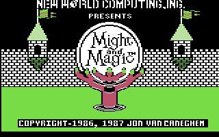 |
| Title frame, second | 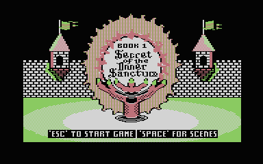 | 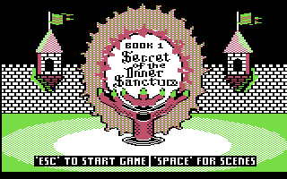 |
| Scene 2 | 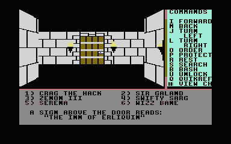 | 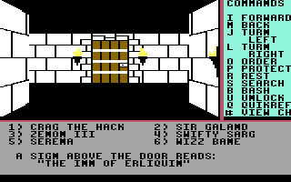 |
| Scene 3 | 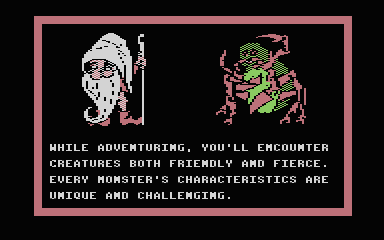 | 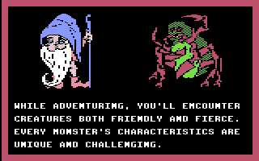 |
| Scene 4 | 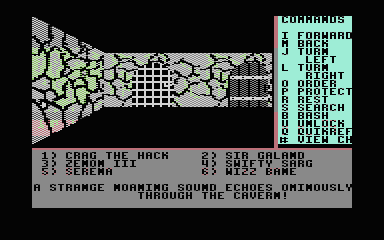 | 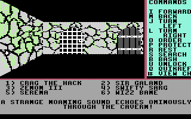 |
| Scene 5 | 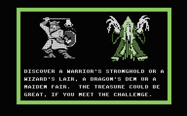 | 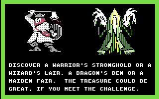 |
| Scene 6 | 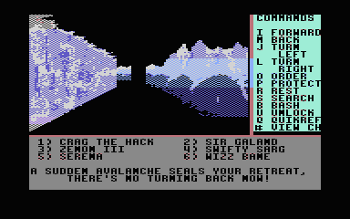 | 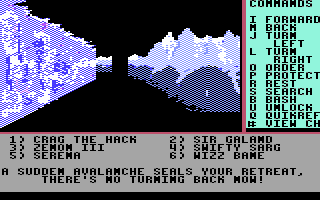 |
| Scene 7 | 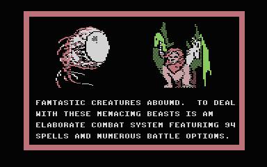 | 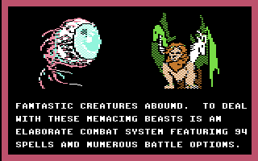 |
| Scene 8 | 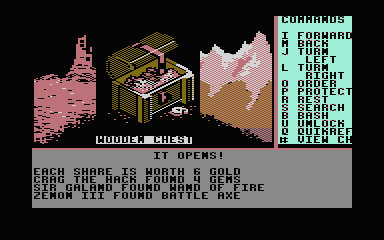 | 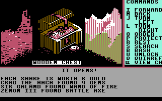 |
| Scene 9 | 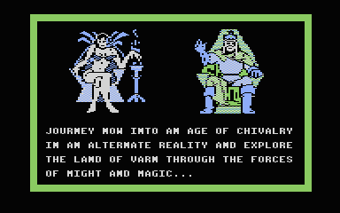 | 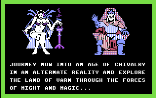 |

**2026-10-12 subsequent game-kernel follow-up:** broader gameplay coverage changes the underlying kernel's clock guard and memory layout, and walking conversion is faster. The title stage itself is unchanged; re-run the title tests with this build. Historical disk hashes above refer to the title implementation before that follow-up. [Coverage](GAMEPLAY-COVERAGE.md), [walking](WALKING-PERFORMANCE.md).

The startup equivalence check now captures both title/plain first prompts at KERNAL clock `$000080`, after settling. Matching frame counts alone left jiffies a couple of ticks different following the conversion-clock guard. The first prompt polls directly, so this alignment does not advance the game's dice counters; no memory comparison exclusion was added.


## Stock 64 KB startup stage — 2026-10-13

**Implemented / emulator-checked:** `build.py --65xe` now includes the original
intro. A temporary direct-frame/scene renderer and three-voice music translator
use RAM before the game loads, not an extended bank. All permanent kernel
segments remain byte-identical to the no-title 65XE build. Scene role plans and
a 256-byte nibble map retain original runtime bitmap drawing. Both animated
frames, all eight scenes, tune, loop and Escape are checked independently;
all 21 gameplay scripts pass afterward. The scenes keep their original colour
metadata; unlike the 130XE renderer, the host-derived plans already account for
portrait preparation. [Allocations, commands and evidence](65XE.md).
